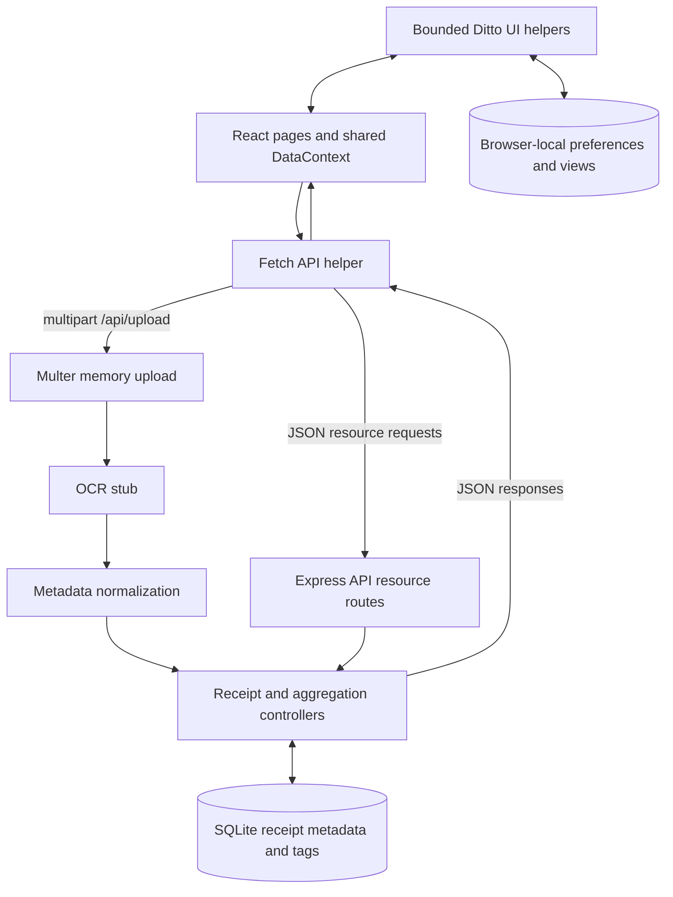

# Architecture

CollectorCheck runs as a React frontend on port 3001 and an Express backend on port 4000. Receipt metadata and tags persist in SQLite; OCR remains a stub.

## Request Flow

1. Upload sends multipart field `file` plus optional vendor, date, and amount to `/api/upload`.
2. Multer validates JPEG, PNG, or PDF uploads up to 5 MiB and buffers the file in memory. The OCR stub returns empty extraction values; supplied metadata takes precedence before normalization.
3. Controllers store normalized receipt metadata in SQLite. List and detail endpoints read those records; vendor, tag, stats, and timeline endpoints derive their responses from them.
4. Detail edits and deletion use `/api/receipts/:id`. Shared frontend receipt updates refresh the affected resource pages.

## Boundaries

- The canonical resources are under `/api`; unprefixed and legacy receipt routes remain for compatibility. See the [API reference](API.md).
- `/api/upload` does not retain original file bytes. Legacy disk-backed uploads store files under `backend/uploads/`.
- Ditto provides contextual UI help, static cultural moments, light tone, and explicitly triggered organization commands. It does not perform narrative, mood, life-event, behavioral, or regulated-domain inference.
- There are no usage-history-based action predictions or tax-category inference paths. User-entered tags remain ordinary labels.
- Ditto organization changes are browser-local/shared-state operations; receipt-detail edits persist through the backend.
- The MVP API has no authentication and is intended for local development, not an unreviewed public deployment.

The source repository is [Isotherm-Applied-Sciences/collectorcheck](https://github.com/Isotherm-Applied-Sciences/collectorcheck). See [folder structure](folder-structure.md) and [setup](setup.md) for implementation paths and verification steps.